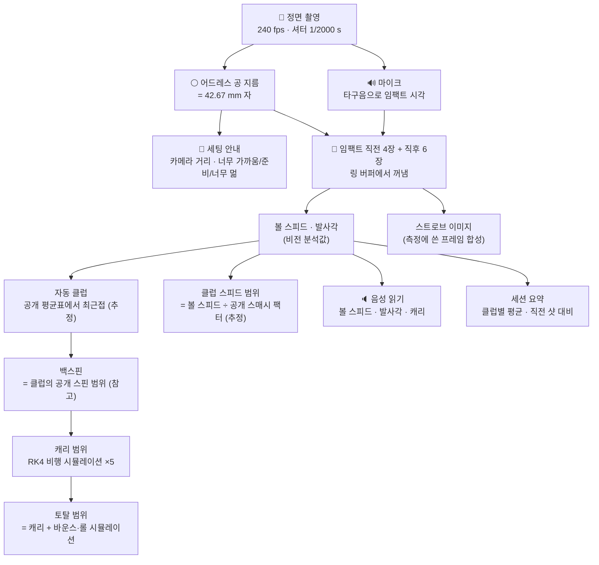

# 런치모니터 리드아웃 — 동작 원리 (상세)

> 2026-11-08 업데이트에서 추가된 **6개 타일 리드아웃**(캐리 · 토탈 · 볼 스피드 · 클럽 스피드 · 백스핀 · 발사각), **세팅 거리 안내**, **자동 클럽**, **스트로브**, **세션 요약**, **음성 읽기**가 안에서 정확히 어떻게 계산되는지 적은 문서예요. 수식, 코드의 상수, 예시 숫자, 그리고 "이건 왜 측정이 아닌가"까지 전부 담았어요. 영어판은 [LaunchReadout.md](LaunchReadout.md), 짧은 설계 문서는 [../Specs/LaunchMonitor.md](../Specs/LaunchMonitor.md)예요.

---

## 0. 한눈에 보기



| 타일 | 어디서 오나 | 앱의 출처 배지 | 저장되나 |
|---|---|---|---|
| 볼 스피드 | 영상 속 공의 이동 거리 ÷ 시간 | 비전 분석값 | ✅ (`LaunchShot`) |
| 발사각 | 같은 추적선의 기울기 | 비전 분석값 | ✅ |
| 캐리 | 측정한 속도·각도 + 공개 스핀 범위로 비행 시뮬레이션 | 시뮬레이션 | ❌ (볼 때마다 다시 계산) |
| 토탈 | 캐리 + 바운스·롤 모델 | 시뮬레이션 | ❌ |
| 클럽 스피드 | 볼 스피드 ÷ 공개 스매시 팩터 범위 | 추정값 | ❌ |
| 백스핀 | 그 클럽의 공개 스핀 범위 그대로 | 참고 — 발표된 평균값 | ❌ |

핵심 규칙 하나: **저장되는 건 측정값 두 개뿐**이에요. 나머지는 화면을 그릴 때마다 측정값과 공개 데이터로 다시 계산하고, 저마다 배지로 정체를 밝혀요. 추정값이나 사용자 입력값을 넣으면 리드아웃 자체가 만들어지지 않아요(`LaunchReadoutBuilder`가 `measured`/`visionDerived`가 아닌 볼 스피드를 거부).

---

## 1. 아이폰 한 대가 볼 수 있는 것, 없는 것

센서는 두 개예요. **후면 카메라**(240 fps, 셔터 1/2000 s)와 **마이크**. 그래서:

- **볼 수 있는 것**: 공이 날아가기 시작한 처음 2~5프레임 동안 화면 안에서 몇 픽셀 움직였는지, 그리고 타구음이 난 순간.
- **볼 수 없는 것**:
  - **스핀.** 7,000 rpm은 초당 116.7회전이에요. 240 fps면 **프레임당 0.49회전**이라 한 프레임 사이에 거의 반 바퀴를 돌아요. 무늬를 추적해도 어느 쪽으로 몇 바퀴 돌았는지 구분이 안 돼요(에일리어싱). 게다가 3 m 거리에서 공은 14~21 px 크기라 무늬 자체가 안 보여요. 드라이버의 2,500 rpm도 프레임당 0.17회전인데 이것도 무늬 해상도가 부족해요.
  - **클럽 헤드 스피드.** 헤드가 공과 같은 깊이에 있다는 보장이 없고, 임팩트 직전 헤드는 블러와 몸에 가려지는 문제가 있어요. 이 프로젝트의 클럽 추적(`SeededClubTrack`)은 백스윙 구간 이미지 평면 움직임만 다루고 속도를 내지 않아요.
  - **좌우 발사 방향·스핀축.** 정면 촬영에서는 깊이 방향이라 안 보여요.

그래서 스핀과 클럽 스피드는 **"공개 데이터로 대신한 값"**이라고 배지에 적어요. 숫자를 보여주되 측정이라고 말하지 않는 게 이 앱의 규칙이에요.

---

## 2. 촬영 조건: 왜 240 fps, 왜 1/2000 s인가

**프레임 수.** 드라이버 볼 스피드 74 m/s는 프레임당(1/240 s) 31 cm, 7번 아이언 54 m/s는 22 cm 움직여요. 3 m 거리에서 세로로 찍은 720 px 폭 화면(공 14 px)이면 픽셀로는 각각 **101 px, 74 px/프레임**. 추적 영역은 화면 폭의 65 %(≈ 468 px)라서 드라이버는 3~4프레임, 7번 아이언은 5~6프레임 안에 공이 보여요. 직선을 맞추려면 2점은 필요하고 3점 이상이면 좋아요.

**셔터.** 셔터를 1/240 s로 두면 한 프레임 동안 공이 **31 cm(7개 공 지름)**나 번져서 위치를 못 잡아요. 1/2000 s면 **3.7 cm = 공 지름의 0.87배**라 둥근 점으로 남아요(`LaunchTracker.maximumExposure = 1/1000 s`보다 길면 측정 거부). 셔터를 짧게 하면 어두워지니 ISO를 셔터 단축 비율만큼 올려요. 그 포맷의 최대 ISO로도 부족하면 "너무 어두움"이라고 알리고 숫자를 내지 않아요(`LaunchModeState.tooDark`).

**셔터를 모르는 영상.** 사진 앱에서 가져온 클립은 노출 시간을 몰라요. 이때는 번진 길이가 **공 지름의 4배**를 넘는 블롭을 거부해서 간접적으로 걸러요(`exposure == nil` 경로).

---

## 3. 공 지름이 자가 되는 이유 (스케일)

골프공 지름은 USGA 규칙상 **42.67 mm 이상**이고 실제 공은 거의 그 값이에요. 그래서 어드레스에 놓인 공이 화면에서 몇 픽셀인지 재면 **그 깊이에서 1 px가 몇 mm인지**를 알 수 있어요.

```
mm/px = 42.67 / 공 지름(px)
```

**어떻게 재나(`BallScaleFitter`).**
1. 탭한 점 주변(검색 반경 = 화면 폭/40, 최소 20 px) 안에서 가장 밝은 픽셀을 씨앗으로 잡아요.
2. 테두리 픽셀의 중앙값을 배경, 안쪽 99퍼센타일을 피크로 두고, 피크 − 배경이 0.15(0~1 밝기) 미만이면 "공 없음".
3. 각 픽셀의 가중치 = (밝기 − 배경)/(피크 − 배경)을 0~1로 자르고, 0.5 초과를 마스크로 삼아 8-연결 블롭을 찾아요.
4. 블롭 가장자리의 **부분 픽셀**까지 가중치로 더해 면적 A를 구하고, 지름 = **2√(A/π)**. 테두리에 닿거나 가로세로비가 1.35를 넘거나 6 px 미만이면 거부.
5. 어드레스 프레임 **4장**(임팩트 0.25, 0.20, 0.15, 0.10 s 전)에서 각각 재고, 최소 3장이 성공하고 **표준편차/평균 < 5 %**일 때만 채택. 평균 지름과 평균 중심이 스케일이 돼요.

**왜 서브픽셀인가.** 21 px짜리 공에서 1 px 오차는 **5 %** 속도 오차예요. 면적 기반 서브픽셀 추정은 합성 영상에서 0.3 px 안쪽이라 1~2 %로 줄어요. 상대 불확실성은 `max(SD, 0.2 px) / 지름`으로 잡아요(아무리 잘 맞아도 0.2 px 바닥).

---

## 4. 임팩트 시각: 소리로 잡는다

영상만으로 "지금 쳤다"를 알아내려면 매 프레임을 분석해야 해서 느려요. 대신 **마이크**를 써요.

**실시간 트리거(`StreamingImpactTrigger`).**
- 오디오 버퍼가 들어올 때마다 샘플 1차 차분의 피크를 구해 최근 64개 버퍼 피크의 중앙값을 "바닥"으로 삼아요.
- 피크가 바닥보다 **12 dB** 이상 크면 후보. 후보 뒤로 **60 ms**가 더 들어오면 최근 1초 분량에 `ImpactOnsetDetector`를 돌려 정확한 시각을 확정해요.
- 확정 후 **1.5초**는 다시 반응하지 않아요(메아리, 공이 매트에 떨어지는 소리 무시).
- 합성 테스트에서 임팩트 시각 오차는 **1 ms 이내**예요.

**링 버퍼(`FrameRing`).** 카메라 프레임은 공 주변 영역만 잘라 링에 쌓아요. 용량은 (0.25 + 0.06 + 0.2) s × 240 fps 올림 + 16 = **139프레임(0.51 s)**. 임팩트 시각이 확정되면 그 전 0.25/0.20/0.15/0.10 s에 가장 가까운 프레임 4장(허용 오차 1.5프레임)과 임팩트 **뒤 6프레임**을 꺼내요. 6프레임이 쌓이기까지 약 25 ms, 소리 확정 60 ms, 전달 지연 20 ms를 합쳐 **임팩트 후 약 0.1 s**면 계산할 재료가 다 모여요.

오디오와 비디오 타임스탬프는 같은 캡처 세션 시계를 써서 바로 비교해요.

---

## 5. 공 추적: 어디로 갔는지 찾기 (`LaunchTracker.observe`)

어드레스 프레임(마지막 한 장)을 기준으로 임팩트 후 프레임마다:

1. **차분.** 픽셀마다 `(현재 − 기준) / 공의 대비`를 0~1로 잘라 가중치, 0.3 초과를 마스크.
2. **볼 영역만.** 공이 날아가는 방향으로 공 반지름 r보다 앞(`dx·방향 > r`), 공 중심선보다 아래가 아닌 곳(`dy ≤ r`), 그리고 공이 있던 자리 반경 2r 바깥만 봐요. (공이 사라진 자리는 "어두워진" 변화라 차분이 음수이고, 클럽헤드는 대개 공 뒤에 있어요.)
3. **블롭.** 8-연결 성분 중 면적이 공 면적의 30 % 이상이고 테두리에 닿지 않은 것만 후보.
4. **예측 위치.** 관측이 2개 이상이면 직전 두 점의 등속 외삽, 아니면 마지막 점(또는 어드레스 위치)에 가장 가까운 블롭을 고름.
5. **전진 조건.** 직전 점보다 방향으로 r 이상 나아가지 않은 블롭은 공이 아니에요(가만히 있는 밝은 것).
6. 각 관측의 시각은 **노출 창의 중앙**(프레임 시각 + 노출/2). 노출을 모르는 영상은 프레임 시각 그대로 쓰는데, 일정한 오프셋은 속도 계산에서 사라져요.

---

## 6. 볼 스피드와 발사각 (`LaunchTracker.fit`)

관측 (t_i, x_i, y_i)에 대해 x(t)와 y(t)를 각각 **최소제곱 직선**으로 맞춰요.

```
a_x = Σ(t−t̄)(x−x̄) / Σ(t−t̄)²,   a_y 도 같은 식
속도 [m/s]   = √(a_x² + a_y²) × (mm/px) / 1000
발사각 [rad] = atan2(−a_y, |a_x|)        (화면 y는 아래가 +이므로 부호 반전)
```

**직선으로 충분한 이유.** 처음 20 ms 동안 중력이 공을 떨어뜨리는 거리는 ½·g·t² = **1.96 mm**. 픽셀 하나(약 2~3 mm)보다 작아요.

**불확실성과 신뢰도.**
```
잔차       = √(평균(직선에서 벗어난 거리²))      [px]
위치 오차  = max(잔차, 0.5 px)
상대 불확실성 = √( (스케일 상대 불확실성)² + (√2 × 위치 오차 / 추적 구간 길이)² )
신뢰도    = clamp(1 − 상대 불확실성 / 0.10, 0, 0.95) × (점 3개 이상이면 1, 2개면 0.8)
```
예: 21 px 공(스케일 불확실성 0.2/21 ≈ 0.95 %), 잔차 0.5 px, 추적 길이 300 px → 상대 불확실성 0.98 %, 신뢰도 **0.90**. 신뢰도 상한이 0.95인 건 실기기 검증 전에는 "확실하다"고 말하지 않으려는 뜻이에요.

**거부.** 속도가 5~95 m/s 밖이면 "타구로 볼 수 없는 움직임"으로 거부. 점이 1개면 거부.

**합성 영상 결과**(480×360, 0.4922 px/mm, 공만 있고 몸·클럽·롤링셔터·압축 없음): 54 m/s@16° → 53.95 m/s, 16.00°; 74 m/s@10.5° → 73.97, 10.50°. **실제 영상 정확도는 아직 모르고**, TrackMan 옆에서 10샷 이상 ±3 %, ±1.5° 안에 들어야 "실험적" 딱지를 떼요.

---

## 7. 캐리: 왜 범위이고, 어떻게 계산하나

캐리는 측정이 아니라 **시뮬레이션**이에요. 측정한 볼 스피드와 발사각을 넣고, 모르는 **스핀**은 그 클럽의 **공개 스핀 범위**를 통째로 넣어서 "최단~최장"을 보여줘요.

**스핀 범위(`ReferenceLaunchData.spinAssumption`).** 투어 평균표(TrackMan PGA/LPGA 2023, 구판 PGA/LPGA)와 USGA R22-01 표에서 그 클럽의 스핀 값을 모두 모아 최소~최대. 7번 아이언이면 **6,630~7,124 rpm**(출처 4개). 이 범위를 **5점**(양끝 포함 등간격)으로 샘플링해요.

**비행 모델(`BallFlight`).** 점질량 RK4, 시간 간격 1 ms.
- 항력 C_D = 0.24 + 0.18·S, 양력 C_L = 0.54·S^0.4, S = r·ω/V (Smits & Smith 1994의 2차 인용 형태)
- 스핀 감쇠 dω/dt = −2×10⁻⁵·ω·V/r
- 공기 밀도: 습공기 이상기체(20 °C, 101,325 Pa, 습도 50 % 기본)
- 질량 45.93 g, 지름 42.67 mm, 바람 0, 평지 착지

5번 돌려 나온 캐리의 **최소·최대**가 타일의 두 끝이에요. 예: 54 m/s, 16°, 7번 아이언 → **171.9~173.3 m**(범위가 좁은 건 투어 스핀 범위가 좁아서예요. 아마추어 스핀은 이보다 넓게 퍼질 수 있고, 이 모델은 아이언 캐리를 약 8 % 길게 내는 걸로 알려져 있어요 — [../Physics.md](../Physics.md)). 같은 5번의 비행에서 **최고 높이(apex) 범위**도 나와요.

**레인지 그림.** 5번 중 가운데(스핀 중앙값) 궤적을 **점선**으로 그려요. 점선인 이유는 "관측한 궤적"처럼 보이지 않게 하려는 거예요. 바닥의 진한 띠가 캐리 범위, 연한 띠가 토탈 범위. 높이는 과장돼 있고 축척은 없어요(옆에 그렇게 적혀 있어요).

---

## 8. 토탈: 바운스·롤 모델 (`BallRoll`)

토탈 = 캐리 + **런(run)**. 런은 착지 후 튀고 구르는 거리인데 이것도 전부 시뮬레이션이에요. 잔디 상태는 재지 않고 "보통 페어웨이"라는 가정을 이름 붙여 써요(`TurfSurface.fairway`).

입력은 비행 시뮬레이션이 내준 **착지 속도 v, 착지각 θ(수평 아래), 착지 스핀 ω**(5번 각각).

### 8.1 기울어진 지면
공은 잔디를 파고들면서 앞으로 가던 속도를 많이 잃어요. 평평한 바닥 모델은 이걸 못 잡아서 앞으로 너무 많이 굴러요. 그래서 바닥의 법선을 공이 오는 쪽으로 θ_c만큼 **기울여** 계산해요.

```
θ_c = 15.4° × (v / 18.6 m/s) × (θ / 44.4°),   최대 40°
입사각 = θ + θ_c (최대 89°)
v_n = v·sin(입사각),  v_t = v·cos(입사각)
```
예: 7번 아이언 착지 25.3 m/s, 46.2° → θ_c = **21.8°**, 드라이버 28.7 m/s, 43.3° → 23.2°.

### 8.2 수직 반발
```
e = 0.510 − 0.0375·v_n + 0.000903·v_n²   (0.12 ≤ e ≤ 0.9)
v_n' = e·v_n
```
v_n = 5 m/s면 e = 0.35, 10 m/s면 0.23, 20.8 m/s에서 최소 0.12, 28.7 m/s면 0.18. 빠르게 떨어질수록 덜 튀는 잔디의 성질이에요.

### 8.3 접선 성분: 왜 (5v_t − 2rω)/7 인가
충돌 중 마찰 충격량은 접촉점에서 작용하므로 **접촉점 기준 각운동량이 보존**돼요. 접촉이 끝날 때 공이 미끄러지지 않고 구른다고 하면(v' = r·ω'):

```
m·v_t·r − I·ω_b = m·v'·r + I·(v'/r),   I = (2/5)·m·r²  (균질한 구)
→ v'·(1 + 2/5) = v_t − (2/5)·r·ω_b
→ v' = (5·v_t − 2·r·ω_b) / 7
```
백스핀 ω_b가 크면 v'가 작아지고(심하면 음수 = 뒤로 튐), 튄 뒤 공은 v'/r의 **톱스핀**으로 바뀌어요. 두 번째 바운스부터는 톱스핀이라 접선 속도를 거의 안 잃어요.

### 8.4 다시 지면 좌표로, 홉, 반복
```
수평 = v'·cos θ_c + v_n'·sin θ_c
수직 = v_n'·cos θ_c − v'·sin θ_c
홉 거리 = 2·수평·수직 / g
```
수직이 0 이하이거나 수평이 0 이하이면(뒤로 튐) 바로 롤로 넘어가요. 그 외에는 새 속도·각도로 다음 바운스를 계산하고, 홉이 **공 지름(4.27 cm)보다 짧아지면** 멈춰요(최대 12회).

### 8.5 롤
```
롤 거리 = v_ground² / (2·a),   a = 2.0 m/s²  (부호 있음: 뒤로 튄 공은 뒤로 굴러요)
```
a = 2.0은 "그린(스팀프 10피트 ≈ 0.6 m/s²)보다 훨씬 느린 보통 페어웨이"라는 가정값이에요. 근거 데이터는 없어요.

### 8.6 기준 샷에서 나오는 숫자
| 샷 | 착지 | 런 | 바운스 | 토탈 |
|---|---|---|---|---|
| 드라이버 (167 mph, 10.9°, 2686 rpm) | 28.7 m/s, 43.3°, 2094 rpm | 16.3 m (17.8 yd) | 2 | 290.8 yd |
| 3번 우드 | 27.6 m/s, 42.3°, 2891 rpm | 14.7 m | 2 | 274.1 yd |
| 7번 아이언 (120 mph, 16.3°, 7097 rpm) | 25.3 m/s, 46.2°, 5951 rpm | 5.3 m (5.8 yd) | 3 | 192.4 yd |
| 피칭 웨지 | 24.1 m/s, 49.7°, 8069 rpm | 1.1 m | 3 | 144.9 yd |

테스트는 드라이버 10~45 m, 7번 아이언 2~20 m, 스핀이 크면 런이 줄고 착지각이 낮으면 늘고, 60° 고스핀 로브는 −8~5 m라는 **상식 범위**만 확인해요. 실측 토탈과 비교한 적은 없고, 반발계수 다항식과 기울기 15.4°는 Penner(2002) 모델을 2차 인용한 값이에요. 그래서 토탈 타일의 배지는 "시뮬레이션"이고, 각주에 페어웨이 가정이라고 적혀 있어요.

---

## 9. 클럽 스피드: 추정값인 이유와 계산

**스매시 팩터** = 볼 스피드 ÷ 클럽 스피드. 같은 클럽이면 좁은 범위에 들어요(7번 아이언 공개값 1.33~1.41: PGA 1.34, LPGA 1.38, 구판 1.33/1.38, USGA 잔디 1.33, 매트 1.41).

```
클럽 스피드 최저 = 볼 스피드 / 스매시 최대,   최고 = 볼 스피드 / 스매시 최소
```
예: 54 m/s → **38.3~40.6 m/s (85.7~90.8 mph)**. 신뢰도는 볼 스피드 측정의 신뢰도를 그대로 물려받고 배지는 **추정값**이에요. 미스샷(토핑, 힐)은 스매시가 낮아서 실제 클럽 스피드가 이 범위보다 높을 수 있어요 — 그래서 측정이 아니라고 적어요. 스매시 팩터 자체는 "측정 불가"로 남아요.

---

## 10. 백스핀: 참고값인 이유

1절에서 본 대로 측정이 안 돼요. 타일에 적히는 숫자는 7절에서 캐리를 시뮬레이션할 때 넣은 **공개 스핀 범위 그대로**예요(7번 아이언 6,630~7,124 rpm). 이걸 위해 출처 종류에 **`reference`("참고 — 발표된 평균값")**를 새로 넣었어요. 이 배지가 붙은 숫자는 "당신 샷"이 아니라 "출판된 골퍼 집단"을 말해요. 저장되지 않고, 통계에도 섞이지 않아요.

---

## 11. 자동 클럽 (`ReferenceLaunchData.nearestClub`)

클럽을 안 고르면 측정한 (볼 스피드, 발사각)에 가장 가까운 공개 행의 클럽을 골라요. 행은 70개(투어 4표 × 11~12클럽 + USGA 그룹표).

```
거리 = √( ((v − v_i) / 4 m/s)² + ((θ − θ_i) / 3°)² )
```
4 m/s(≈ 9 mph)와 3°를 "같은 무게"로 본 정규화예요. 가장 가까운 행의 클럽이 답이고, **다른 클럽**의 최근접 행과의 마진으로 신뢰도를 만들어요:

```
마진 = 1 − 최근접 거리 / 차순위(다른 클럽) 거리
근접 = max(0, 1 − 최근접 거리 / 4)
신뢰도 = clamp(마진 × 근접, 0, 1)
```
예: PGA 7번 아이언 행과 정확히 같은 (123 mph, 16.1°)면 신뢰도 1. 54 m/s, 16°면 7번 아이언, 신뢰도 0.77. 공개 행에서 멀리 떨어진 (60 mph, 40°)는 근접이 0이라 신뢰도 0 — 그래도 가장 가까운 클럽은 알려줘요.

**한계.** 표는 투어와 USGA 그룹이라, **아마추어의 7번 아이언이 투어 8번 아이언 행**에 붙을 수 있어요. 그래서 자동 클럽은 "스핀 범위를 어느 클럽 걸로 쓸지"를 고르는 추정일 뿐이고, 메뉴에서 바꿀 수 있고, 각주에 어떤 클럽을 왜 골랐는지 적혀요. 클럽 선택은 캐리·토탈·백스핀·클럽 스피드 네 타일에만 영향을 주고 측정값 두 개는 바뀌지 않아요.

---

## 12. 세팅 거리 안내 (`LaunchSetupChecker`)

공을 탭하면 임팩트를 기다리기 전에 **어드레스 프레임 4장**(4프레임 간격으로 뽑아 잠깐 가려져도 버티게)을 먼저 3절과 같은 방법으로 맞춰요. 여기서 두 가지가 나와요.

### 12.1 카메라 거리
핀홀 카메라 모델이에요. 렌즈의 수평 화각(`AVCaptureDeviceFormat.videoFieldOfView`)과 센서 폭 픽셀 W로 픽셀 초점거리를 구하고:

```
f_px = (W / 2) / tan(화각 / 2)
거리 [m] = f_px × 42.67 / 공 지름(px) / 1000
```
예: 화각 60°, W = 1280 → f_px = 1108.5. 공이 14 px면 **3.38 m**, 21 px면 2.25 m, 42 px면 1.13 m. 배지는 비전 분석값. 화각을 모르면(어떤 포맷) 거리는 "측정 불가"로 두고 판정만 해요.

### 12.2 판정
```
프레임당 이동(px) = 80 m/s × 1000 × (지름/42.67) / fps
체류 프레임 수 = (공 앞쪽 여유 px) / 프레임당 이동
```
- 지름 < **10 px** → **너무 멂** (스케일 바닥 불확실성 0.2/10 = 2 %가 넘기 시작)
- 체류 프레임 < **2.5** → **너무 가까움** (강한 드라이브를 기준으로 2~3점을 못 찍음)
- 그 외 → **준비 완료**

같은 예시에서 14 px면 3.8프레임(준비), 21 px면 2.5(경계), 42 px면 1.2(너무 가까움), 8 px면 너무 멂.

### 12.3 권장 범위
판정이 준비가 아닐 때 "약 2.2~4.7 m에 두세요"처럼 알려줘요. 위 두 조건을 거리로 바꾼 거예요:
```
가장 큰 허용 지름 = 공 앞쪽 여유 × 42.67 × fps / (80,000 × 2.5)
가장 가까운 거리 = f_px × 42.67 / 가장 큰 허용 지름 / 1000
가장 먼 거리    = f_px × 42.67 / 10 / 1000
```
예시(여유 414 px): 허용 최대 21.2 px → **2.23~4.73 m**. 공 앞쪽 여유는 지금 탭한 위치 기준이라, 공을 화면 가장자리에 두면 범위가 사라질 수도 있어요(그땐 범위를 안 보여줘요).

이 검사는 세팅 때 한 번이고, **샷마다 스케일은 다시 재요**(공을 다시 올린 자리가 조금 달라도 괜찮게).

---

## 13. 스트로브 (`LaunchStrobe`)

리플레이 영상은 아직 저장하지 않아요. 대신 측정에 쓴 **어드레스 프레임 1장 + 비행 프레임 6장**을 픽셀마다 **최댓값**으로 합쳐요. 공은 배경보다 밝으니 프레임마다 한 번씩 찍힌 점들이 한 장에 남고, 그 위에 추적기가 실제로 쓴 중심점을 동그라미로 표시해요. "측정이 무엇을 봤는지"를 보여주는 그림이지 영상이 아니에요. 저장되지 않아요.

---

## 14. 세션 요약 (`LaunchSession`)

실시간 측정을 켠 뒤 잰 샷을 메모리에 모아요(저장은 런치 기록에 따로).
- **클럽별 평균** 볼 스피드·발사각: 산술평균, 출처는 비전 분석값(측정값의 평균이라서).
- **표준편차**: n − 1 표본 표준편차, **5샷**부터(코칭 문장과 같은 기준).
- **캐리 범위**: 그 클럽 샷들의 시뮬레이션 범위를 합친 최소~최대(시뮬레이션).
- **직전 샷 대비 변화**: 같은 클럽의 바로 전 샷과의 차이(볼 스피드, 발사각). 시간순으로 정렬해서 비교하고, 그 클럽의 첫 샷이면 안 보여요. 코칭이 아니라 그냥 차이예요.
- **마지막 샷 취소**: 세션 목록과 런치 기록(`LaunchShot`)에서 함께 지워요. 연습 스윙이나 미스샷용.

---

## 15. 음성 읽기 (`LaunchSpeaker`)

샷마다 "볼 스피드 118 mph. 발사각 16°. 캐리 172 m에서 173 m." 형식으로 앱 언어로 읽어요(12개 언어 템플릿 `launch.voice.launch`, `launch.voice.carry`). **스핀과 클럽 스피드는 읽지 않아요** — 귀로 들으면 배지가 안 보여서 측정처럼 들리니까요. 패널의 스피커 버튼, 설정 → 코칭 → 음성 읽기로 끌 수 있어요.

---

## 16. 출처(provenance) 규칙과 저장 규칙

| 출처 | 뜻 | 리드아웃에서 |
|---|---|---|
| `visionDerived` | 영상에서 계산 | 볼 스피드, 발사각, 카메라 거리, 세션 평균 |
| `audioDerived` | 소리에서 계산 | 임팩트 시각 |
| `simulated` | 물리 모델 | 캐리, 토탈, 최고 높이, 레인지 그림 |
| `estimated` | 규칙으로 추정 | 클럽 스피드, 자동 클럽 |
| `reference` | 발표된 평균값 | 백스핀 범위 |
| `unavailable` | 모름 | 화각 없는 포맷의 카메라 거리, 스매시 팩터 |

- `LaunchShot`에 저장되는 건 볼 스피드(m/s), 발사각(rad), 출처, 신뢰도, 상대 불확실성, 추적 점 개수, 방법 ID, 그리고 **어느 클럽 범위를 썼는지**(참고용 ID)뿐이에요.
- 시뮬레이션·추정·참고 값은 저장하지 않아요. 런치 기록은 볼 때마다 저장된 측정값으로 다시 계산해요.
- `ProvenancedValue`는 값·단위·방법이 비거나 출처가 `unavailable`이면 값을 버려요. 문자열로 출처를 비교하는 코드는 검사 스크립트가 거부해요(`Scripts/verify.sh`).
- 리드아웃 빌더는 측정/비전 출처가 아닌 볼 스피드를 받으면 nil을 돌려줘요. 가상 비행 화면에서 손으로 넣은 값이 리드아웃으로 둔갑할 길이 없어요.

---

## 17. 정확도와 검증 상태 (솔직하게)

| 항목 | 상태 |
|---|---|
| 합성 영상(공만, 압축 없음) | 속도 0.1 %, 각도 0.01° 이내 |
| 합성 스트림 지연 | 임팩트 후 ≈ 0.1 s에 재료 준비, 1 ms 이내 임팩트 시각 |
| 실제 iPhone 촬영 | **미검증** (방향·드롭 프레임·지연·세팅 검사·음성 포함) |
| TrackMan 대조 | **미검증**. 10샷 이상 ±3 % / ±1.5° 안이면 "실험적" 제거 |
| 캐리 모델 | 투어 평균 대비 드라이버 −0.7 %, 7번 아이언 +8.5 % (최고 높이는 +19~32 %) |
| 롤 모델 | 실측 비교 없음 |
| 클럽 스피드·백스핀 | 측정이 아니므로 정확도를 논할 수 없음 |

이 환경(리눅스, Swift 6.2.3)에서 코어 테스트 97개는 통과했지만 iOS 빌드와 시뮬레이터 테스트는 돌리지 못했어요. Mac에서 `xcodebuild … test`를 돌려 주세요.

---

## 18. 코드 지도

| 파일 | 역할 |
|---|---|
| `Sources/SwingLabCore/LaunchMonitorImaging.swift` | 8비트 회색 이미지, 블롭 찾기 |
| `Sources/SwingLabCore/LaunchMonitor.swift` | 공 스케일(`BallScaleFitter`), 추적·직선 맞춤(`LaunchTracker`), 캐리 범위(`CarryRangeEstimator`) |
| `Sources/SwingLabCore/LaunchMonitorLive.swift` | 추적 영역, 링 버퍼, 스트리밍 임팩트 트리거, 실시간 세션, 프레임 회전, `LaunchPipeline` |
| `Sources/SwingLabCore/ImpactOnsetDetector.swift` | 타구음 온셋 확정 |
| `Sources/SwingLabCore/BallFlight.swift` | RK4 비행 모델 (착지 속도 포함) |
| `Sources/SwingLabCore/BallRoll.swift` | 기울어진 바운스·롤 모델 |
| `Sources/SwingLabCore/ReferenceLaunchData.swift`, `ReferenceLaunchTables.swift` | 공개 평균표, 스핀·스매시 범위, 자동 클럽 |
| `Sources/SwingLabCore/LaunchReadout.swift` | 6개 타일을 만드는 `LaunchReadoutBuilder` |
| `Sources/SwingLabCore/LaunchSetup.swift` | 세팅 거리·판정, 스트로브 |
| `Sources/SwingLabCore/LaunchSession.swift` | 세션 평균·변화 |
| `Sources/SwingLabCore/Provenance.swift` | 출처 종류(`reference` 포함) |
| `SwingLab/Services/CameraService.swift` | 런치 모드(240 fps, 1/2000 s), 실시간 스트림, 컨트롤러 상태 |
| `SwingLab/Services/LiveLaunchCapture.swift` | 프레임·소리 수신, 세팅 검사, 측정, 스트로브 |
| `SwingLab/Services/LaunchSpeaker.swift` | 음성 읽기 |
| `SwingLab/Features/Camera/LiveLaunchPanel.swift`, `LaunchRangeView.swift` | 실시간 패널, 레인지 그림, 스트로브 보기 |
| `SwingLab/Features/FlightSimulation/LaunchReadoutGrid.swift`, `LaunchMeasureView.swift`, `LaunchLogView.swift` | 타일 그리드, 영상 측정 화면, 런치 기록 |
| `Tests/SwingLabCoreTests/LaunchMonitorTests.swift`, `LaunchMonitorLiveTests.swift`, `LaunchReadoutTests.swift` | 합성 영상·스트림·리드아웃 테스트 |
