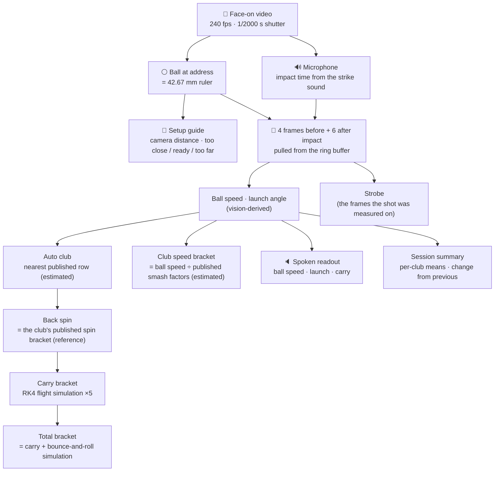

# Launch-monitor readout — how it works, in detail

> The 8 Nov 2026 update added the **six-tile readout** (carry · total · ball speed · club speed · back spin · launch angle), the **setup distance guide**, **auto club**, the **strobe**, the **session summary**, and the **spoken readout**. This document says exactly how each is computed: the formulas, the constants in the code, worked numbers, and why each tile is or is not a measurement. Korean version: [LaunchReadout.ko.md](LaunchReadout.ko.md). The shorter design note is [../Specs/LaunchMonitor.md](../Specs/LaunchMonitor.md).

---

## 0. At a glance



| Tile | Where it comes from | Badge in the app | Stored? |
|---|---|---|---|
| Ball speed | the ball's displacement in the video ÷ time | Vision-derived | ✅ (`LaunchShot`) |
| Launch angle | slope of the same fitted track | Vision-derived | ✅ |
| Carry | measured speed and angle + the published spin bracket, flight simulation | Simulated | ❌ (recomputed on display) |
| Total | carry + bounce-and-roll model | Simulated | ❌ |
| Club speed | ball speed ÷ published smash-factor bracket | Estimated | ❌ |
| Back spin | the club's published spin bracket as it is | Reference — published averages | ❌ |

One rule holds everything together: **only the two measured values are stored.** Everything else is recomputed from them and from published data every time the screen is drawn, and each tile says what it is. An estimated or user-entered speed cannot even produce a readout: `LaunchReadoutBuilder` refuses any ball speed that is not `measured` or `visionDerived`.

---

## 1. What one iPhone can observe, and what it cannot

Two sensors: the **rear camera** (240 fps, 1/2000 s shutter) and the **microphone**. So:

- **Observable:** how many pixels the ball moves in its first 2–5 frames of flight, and the moment of the strike sound.
- **Not observable:**
  - **Spin.** 7,000 rpm is 116.7 revolutions per second: at 240 fps that is **0.49 of a turn per frame**, so the ball turns almost half way between frames and the direction and count of the rotation are ambiguous (aliasing). At 3 m the ball is 14–21 px across, too small to resolve any marking anyway. A driver's 2,500 rpm (0.17 turn per frame) runs into the same resolution limit.
  - **Club head speed.** Nothing guarantees the head is at the ball's depth, and just before impact it is blurred and often occluded by the body. The project's club tracker (`SeededClubTrack`) follows image-plane motion through the backswing and deliberately reports no speed.
  - **Launch direction and spin axis.** Face-on, these lie along the depth axis.

Spin and club speed are therefore shown as **values stood in from published data**, and their badges say so. The app's rule is to show a number only when it can say what the number is.

---

## 2. Capture conditions: why 240 fps and 1/2000 s

**Frames.** A 74 m/s drive moves 31 cm per frame at 240 fps; a 54 m/s 7-iron 22 cm. In a 720 px wide portrait frame at 3 m (ball 14 px), that is **101 px and 74 px per frame**. The tracked region is 65 % of the frame width (≈ 468 px), so a drive stays in view for 3–4 frames and a 7-iron for 5–6. A line needs two points; three or more is better.

**Shutter.** At a 1/240 s shutter the ball smears **31 cm (seven ball diameters)** per frame and its position cannot be found. At 1/2000 s the smear is **3.7 cm = 0.87 diameters**, still a round blob (`LaunchTracker.maximumExposure` is 1/1000 s; anything longer is refused). The shorter shutter is compensated by raising ISO by the same factor; when the format's maximum ISO is not enough the mode reports "too dark" and shows no number (`LaunchModeState.tooDark`).

**Unknown shutter.** Clips imported from Photos carry no exposure time. They are screened indirectly instead: a blob longer than **four ball diameters** is rejected (the `exposure == nil` path).

---

## 3. Why the ball's diameter is the ruler (scale)

A golf ball is at least **42.67 mm** across by rule, and real balls sit at that value. So measuring how many pixels the ball at address spans tells you **how many millimetres one pixel is at the ball's depth**:

```
mm/px = 42.67 / ball diameter (px)
```

**How it is measured (`BallScaleFitter`).**
1. Around the tapped point (search radius = frame width / 40, at least 20 px) the brightest pixel is the seed.
2. The median of the border pixels is the background; the 99th percentile inside is the peak. If peak − background < 0.15 (on a 0…1 scale) there is no ball.
3. Each pixel's weight = (brightness − background) / (peak − background), clipped to 0…1; weights above 0.5 form the mask for an 8-connected blob.
4. The blob's **partial edge pixels** contribute their weights to the area A, and diameter = **2√(A/π)**. A blob touching the border, with an aspect ratio over 1.35, or under 6 px is rejected.
5. This runs on **four address frames** (0.25, 0.20, 0.15, 0.10 s before impact); at least three must succeed and their **standard deviation / mean must be under 5 %**. The mean diameter and centre become the scale.

**Why sub-pixel matters.** On a 21 px ball a 1 px error is **5 %** of speed. The area-based sub-pixel estimate lands within 0.3 px on synthetic frames, which brings that to 1–2 %. The relative uncertainty is `max(SD, 0.2 px) / diameter`: even a perfect fit is floored at 0.2 px.

---

## 4. Impact time from the sound

Finding "the strike just happened" from video alone would mean analysing every frame. The **microphone** does it instead.

**Streaming trigger (`StreamingImpactTrigger`).**
- Each audio buffer yields the peak of its first difference; the median of the last 64 buffer peaks is the "floor".
- A peak **12 dB** above the floor is a candidate. Once **60 ms** more audio has arrived, `ImpactOnsetDetector` runs on the last second of sound and fixes the exact time.
- For **1.5 s** afterwards nothing else triggers (echoes, the ball landing on the mat).
- On synthetic streams the impact time is within **1 ms**.

**Ring buffer (`FrameRing`).** Only the region around the ball is copied from each camera frame into a ring with room for (0.25 + 0.06 + 0.2) s × 240 fps rounded up, plus 16 = **139 frames (0.51 s)**. When the impact time is confirmed, the frames nearest 0.25/0.20/0.15/0.10 s before it (tolerance 1.5 frames) and the **six frames after** it are pulled out. The six frames take about 25 ms, the sound confirmation 60 ms, delivery 20 ms: the material is ready **about 0.1 s after impact**.

Audio and video timestamps share the capture session's clock, so they are compared directly.

---

## 5. Tracking the ball (`LaunchTracker.observe`)

Against the last address frame, for every frame after impact:

1. **Difference.** Per pixel, `(current − reference) / ball contrast` clipped to 0…1 is the weight; weights above 0.3 form the mask.
2. **Only where the ball can be.** More than one radius r ahead of the ball in its flight direction (`dx·direction > r`), not below the ball's centre line (`dy ≤ r`), and outside the vacated spot (radius 2r). (The vacated spot is a darkening, so its difference is negative; the club head is mostly behind the ball.)
3. **Blobs.** 8-connected components with at least 30 % of the ball's area that do not touch the border.
4. **Prediction.** With two or more observations the last two are extrapolated at constant velocity; otherwise the last point (or the address position). The nearest blob wins.
5. **Forward only.** A blob that has not moved at least r ahead of the previous point is not the ball (a static bright thing).
6. Each observation is timed at the **middle of the exposure window** (frame time + exposure / 2). For unknown exposure the frame time is used as is: a constant offset cancels in the velocity.

---

## 6. Ball speed and launch angle (`LaunchTracker.fit`)

Over the observations (t_i, x_i, y_i), x(t) and y(t) each get a **least-squares line**:

```
a_x = Σ(t−t̄)(x−x̄) / Σ(t−t̄)²,   a_y likewise
speed [m/s]   = √(a_x² + a_y²) × (mm/px) / 1000
launch [rad]  = atan2(−a_y, |a_x|)        (image y grows downward, hence the sign)
```

**Why a line is enough.** In the first 20 ms gravity lowers the ball by ½·g·t² = **1.96 mm**, less than one pixel (2–3 mm).

**Uncertainty and confidence.**
```
residual        = √(mean(distance from the line²))      [px]
position error  = max(residual, 0.5 px)
relative uncertainty = √( (scale relative uncertainty)² + (√2 × position error / track length)² )
confidence      = clamp(1 − relative uncertainty / 0.10, 0, 0.95) × (1 with ≥ 3 points, 0.8 with 2)
```
Example: a 21 px ball (scale uncertainty 0.2/21 ≈ 0.95 %), residual 0.5 px, track length 300 px → relative uncertainty 0.98 %, confidence **0.90**. The 0.95 cap exists so nothing claims certainty before device validation.

**Refusals.** Speeds outside 5–95 m/s are refused as "not plausible for a struck ball"; a single point is refused.

**Synthetic results** (480×360, 0.4922 px/mm, ball only, no body, club, rolling shutter or compression): 54 m/s @ 16° → 53.95 m/s, 16.00°; 74 m/s @ 10.5° → 73.97, 10.50°. **Real-video accuracy is unknown.** The "Experimental" label comes off only after 10+ shots beside a TrackMan land within ±3 % and ±1.5°.

---

## 7. Carry: why a bracket, and how it is computed

Carry is a **simulation**, not a measurement. The measured ball speed and launch angle go in; the unknown **spin** goes in as the club's **entire published spin bracket**, and the result is shown as shortest…longest.

**Spin bracket (`ReferenceLaunchData.spinAssumption`).** Every spin value for that club across the tour tables (TrackMan PGA/LPGA 2023 and the older PGA/LPGA tables) and the USGA R22-01 tables, min to max. For a 7-iron: **6,630–7,124 rpm** (four sources). The bracket is sampled at **five** evenly spaced points, ends included.

**Flight model (`BallFlight`).** Point mass, RK4, 1 ms step.
- Drag C_D = 0.24 + 0.18·S, lift C_L = 0.54·S^0.4, S = r·ω/V (the Smits & Smith 1994 form as quoted in secondary literature)
- Spin decay dω/dt = −2×10⁻⁵·ω·V/r
- Moist-air density as an ideal-gas mixture (20 °C, 101,325 Pa, 50 % humidity by default)
- Mass 45.93 g, diameter 42.67 mm, no wind, flat landing

The **minimum and maximum** carry of the five runs are the two ends of the tile. Example: 54 m/s, 16°, 7-iron → **171.9–173.3 m** (narrow because the tour spin bracket is narrow; amateur spin varies more, and this model is known to run iron carry about 8 % long — see [../Physics.md](../Physics.md)). The same five flights give the **apex** bracket.

**Range picture.** The middle run (median spin) is drawn as a **dashed** arc, dashed so it cannot pass for an observed tracer. The dark band on the ground is the carry bracket, the light band the total bracket. Heights are exaggerated and nothing is to scale, and the picture says so.

---

## 8. Total: the bounce-and-roll model (`BallRoll`)

Total = carry + **run**, the distance the ball bounces and rolls after landing, also entirely simulated. The turf is never measured; an "ordinary fairway" assumption is named and used (`TurfSurface.fairway`).

The inputs are the flight model's **landing speed v, landing angle θ (below horizontal), and landing spin ω**, for each of the five runs.

### 8.1 Tilted ground
The ball digs into turf and loses much of its forward speed. A flat-floor model misses this and rolls far too long, so the ground normal is **tilted** toward the incoming ball by θ_c:

```
θ_c = 15.4° × (v / 18.6 m/s) × (θ / 44.4°),   capped at 40°
incidence = θ + θ_c (at most 89°)
v_n = v·sin(incidence),  v_t = v·cos(incidence)
```
Example: a 7-iron landing at 25.3 m/s, 46.2° → θ_c = **21.8°**; a drive at 28.7 m/s, 43.3° → 23.2°.

### 8.2 Normal restitution
```
e = 0.510 − 0.0375·v_n + 0.000903·v_n²   (clamped to 0.12 … 0.9)
v_n' = e·v_n
```
e = 0.35 at 5 m/s, 0.23 at 10 m/s, a minimum of 0.12 at 20.8 m/s, 0.18 at 28.7 m/s: turf gives back less the harder the ball comes down.

### 8.3 The tangential component: why (5v_t − 2rω)/7
The friction impulse acts at the contact point, so **angular momentum about the contact point is conserved** through the impact. If the ball leaves the contact rolling (v' = r·ω'):

```
m·v_t·r − I·ω_b = m·v'·r + I·(v'/r),   I = (2/5)·m·r²  (uniform sphere)
→ v'·(1 + 2/5) = v_t − (2/5)·r·ω_b
→ v' = (5·v_t − 2·r·ω_b) / 7
```
Large backspin ω_b shrinks v' (and can make it negative: the ball kicks back), and after the bounce the ball carries **topspin** v'/r. From the second bounce on, that topspin means almost no tangential loss.

### 8.4 Back to ground axes, the hop, and the loop
```
horizontal = v'·cos θ_c + v_n'·sin θ_c
vertical   = v_n'·cos θ_c − v'·sin θ_c
hop        = 2·horizontal·vertical / g
```
If the vertical component is not positive, or the horizontal one is not (a kick-back), the ball goes straight to rolling. Otherwise the new speed and angle feed the next bounce, until a hop is **shorter than a ball (4.27 cm)**, at most 12 times.

### 8.5 Roll
```
roll = v_ground² / (2·a),   a = 2.0 m/s²  (signed: a kicked-back ball rolls backwards)
```
a = 2.0 is an assumption for a fairway "much slower than a green" (a 10-foot stimp is about 0.6 m/s²); there is no data behind it.

### 8.6 Numbers for the reference shots
| Shot | Landing | Run | Bounces | Total |
|---|---|---|---|---|
| Driver (167 mph, 10.9°, 2686 rpm) | 28.7 m/s, 43.3°, 2094 rpm | 16.3 m (17.8 yd) | 2 | 290.8 yd |
| 3-wood | 27.6 m/s, 42.3°, 2891 rpm | 14.7 m | 2 | 274.1 yd |
| 7-iron (120 mph, 16.3°, 7097 rpm) | 25.3 m/s, 46.2°, 5951 rpm | 5.3 m (5.8 yd) | 3 | 192.4 yd |
| Pitching wedge | 24.1 m/s, 49.7°, 8069 rpm | 1.1 m | 3 | 144.9 yd |

The tests only check **sanity bounds**: driver 10–45 m, 7-iron 2–20 m, more spin means less run, a flatter landing means more, and a 60° high-spin lob stays between −8 and 5 m. Nothing has been compared with measured totals; the restitution polynomial and the 15.4° reference tilt are Penner's (2002) turf model as quoted second-hand. Hence the Simulated badge and the "fairway assumption" footnote.

---

## 9. Club speed: why an estimate, and the arithmetic

**Smash factor** = ball speed ÷ club speed. For one club it sits in a narrow bracket (7-iron published values 1.33–1.41: PGA 1.34, LPGA 1.38, older tables 1.33/1.38, USGA on grass 1.33, on a mat 1.41).

```
lowest club speed = ball speed / highest smash,   highest = ball speed / lowest smash
```
Example: 54 m/s → **38.3–40.6 m/s (85.7–90.8 mph)**. The bracket inherits the ball speed's confidence and wears the **Estimated** badge. A mis-hit (thin, heel) has a lower smash factor, so the real club speed may be above the bracket; that is exactly why it is not called a measurement. Smash factor itself stays Unavailable.

---

## 10. Back spin: why a reference value

Section 1 explains why it cannot be measured. The number on the tile is the **published spin bracket used in section 7** (7-iron: 6,630–7,124 rpm). A new provenance case, **`reference`** ("Reference — published averages"), exists for it. A number with that badge describes a published population of golfers, never your shot. It is not stored and never enters any statistic.

---

## 11. Auto club (`ReferenceLaunchData.nearestClub`)

With no club chosen, the club of the published row nearest to the measured (ball speed, launch angle) is used. There are 70 rows (four tour tables × 11–12 clubs, plus the USGA skill-group tables).

```
distance = √( ((v − v_i) / 4 m/s)² + ((θ − θ_i) / 3°)² )
```
4 m/s (≈ 9 mph) and 3° are weighted equally. The nearest row's club is the answer; the margin over the nearest row of a **different** club gives the confidence:

```
margin    = 1 − nearest distance / runner-up (other club) distance
proximity = max(0, 1 − nearest distance / 4)
confidence = clamp(margin × proximity, 0, 1)
```
Exactly on the PGA 7-iron row (123 mph, 16.1°): confidence 1. At 54 m/s, 16°: 7-iron with confidence 0.77. Far from every row (60 mph, 40°): proximity 0, confidence 0, though the nearest club is still named.

**Limit.** The tables are tour and USGA groups, so **an amateur's 7-iron can land on a tour 8-iron row**. Auto club is only an estimate of which club's spin bracket to simulate with; the menu overrides it, and the footnote says which club was chosen and why. The choice affects the carry, total, back spin, and club speed tiles only; the two measured values never change.

---

## 12. Setup distance guide (`LaunchSetupChecker`)

After the ball is tapped and before the strike is awaited, **four address frames** (four frames apart, so a brief occlusion cannot spoil them all) are fitted as in section 3. Two things come out.

### 12.1 Camera distance
A pinhole camera model. From the lens's horizontal field of view (`AVCaptureDeviceFormat.videoFieldOfView`) and the sensor width W in pixels:

```
f_px = (W / 2) / tan(field of view / 2)
distance [m] = f_px × 42.67 / ball diameter (px) / 1000
```
Example: 60° and W = 1280 → f_px = 1108.5. A 14 px ball is **3.38 m** away, 21 px 2.25 m, 42 px 1.13 m. Badge: vision-derived. Without a field of view (some formats) the distance stays Unavailable and only the verdict is given.

### 12.2 Verdict
```
pixels per frame = 80 m/s × 1000 × (diameter / 42.67) / fps
frames in view   = (room ahead of the ball, px) / pixels per frame
```
- diameter < **10 px** → **Too far** (the scale floor alone, 0.2/10, is 2 %)
- frames in view < **2.5** → **Too close** (a strong drive would not give two or three points)
- otherwise → **Ready**

In the same example 14 px gives 3.8 frames (ready), 21 px 2.5 (the edge), 42 px 1.2 (too close), 8 px too far.

### 12.3 Recommended band
When the verdict is not Ready, the panel says "stand about 2.2–4.7 m from the ball", the two conditions turned into distances:
```
largest allowed diameter = room ahead × 42.67 × fps / (80,000 × 2.5)
nearest distance = f_px × 42.67 / largest allowed diameter / 1000
farthest distance = f_px × 42.67 / 10 / 1000
```
Example (414 px of room): largest 21.2 px → **2.23–4.73 m**. The room ahead is taken from where the ball was tapped, so a ball at the edge of the frame can leave no band at all (then none is shown).

The check runs once at setup; **the scale is re-fitted on every shot** so a ball re-teed slightly elsewhere still measures.

---

## 13. Strobe (`LaunchStrobe`)

No replay clip is saved yet. Instead the **one address frame and six flight frames** used for the measurement are combined pixel by pixel at their **maximum**. The ball is brighter than the background, so it leaves one dot per frame on a single image, and the centres the tracker actually used are circled on top. It is a picture of what the measurement saw, not a video, and it is not stored.

---

## 14. Session summary (`LaunchSession`)

Shots measured since Live readout was switched on are kept in memory (they are saved to the launch log separately).
- **Per-club mean** ball speed and launch angle: arithmetic means, badged vision-derived (means of measurements).
- **Standard deviation**: the n − 1 sample deviation, from **five shots** (the same threshold as coaching sentences).
- **Carry bracket**: the union of the club's simulated brackets, min to max (simulated).
- **Change from the previous shot**: the difference from the previous shot with the same club (ball speed, launch angle), in time order; nothing is shown for a club's first shot. A difference, not coaching.
- **Discard last shot**: removes it from the session list and from the launch log (`LaunchShot`) together, for practice swings and mis-hits.

---

## 15. Spoken readout (`LaunchSpeaker`)

After each shot: "Ball speed 118 mph. Launch 16°. Carry 172 m to 173 m." in the app language (12-language templates `launch.voice.launch` and `launch.voice.carry`). **Spin and club speed are never spoken**: a badge cannot be heard, so they would sound like measurements. The panel's speaker button and Settings → Coaching → Voice readout turn it off.

---

## 16. Provenance and storage rules

| Provenance | Meaning | In the readout |
|---|---|---|
| `visionDerived` | computed from video | ball speed, launch angle, camera distance, session means |
| `audioDerived` | computed from sound | impact time |
| `simulated` | physics model | carry, total, apex, range picture |
| `estimated` | rule-based | club speed, auto club |
| `reference` | published averages | the back-spin bracket |
| `unavailable` | not known | camera distance without a field of view, smash factor |

- `LaunchShot` stores ball speed (m/s), launch angle (rad), provenance, confidence, relative uncertainty, tracked-point count, method ID, and **which club's bracket was used** (an ID, for reference) — nothing else.
- Simulated, estimated, and reference values are never stored. The launch log recomputes them from the stored measurements every time.
- `ProvenancedValue` drops its value when the value, unit, or method is missing or the provenance is `unavailable`. String comparisons of provenance are rejected by the repository check (`Scripts/verify.sh`).
- The readout builder returns nil for any ball speed that is not measured or vision-derived, so a hand-typed value from Hypothetical flight can never turn into a readout.

---

## 17. Accuracy and validation status, honestly

| Item | Status |
|---|---|
| Synthetic video (ball only, no compression) | within 0.1 % on speed, 0.01° on angle |
| Synthetic stream latency | material ready ≈ 0.1 s after impact; impact time within 1 ms |
| Real iPhone capture | **not verified** (orientation, dropped frames, latency, the setup check, and the spoken readout included) |
| TrackMan comparison | **not verified**; 10+ shots within ±3 % / ±1.5° remove "Experimental" |
| Carry model | driver −0.7 %, 7-iron +8.5 % against tour averages (apex +19–32 %) |
| Roll model | no comparison with measured totals |
| Club speed and back spin | not measurements, so accuracy does not apply |

In this environment (Linux, Swift 6.2.3) the 97 core tests pass, but the iOS build and simulator tests could not be run. Please run `xcodebuild … test` on a Mac.

---

## 18. Code map

| File | Role |
|---|---|
| `Sources/SwingLabCore/LaunchMonitorImaging.swift` | 8-bit grey images, blob finding |
| `Sources/SwingLabCore/LaunchMonitor.swift` | ball scale (`BallScaleFitter`), tracking and line fit (`LaunchTracker`), carry bracket (`CarryRangeEstimator`) |
| `Sources/SwingLabCore/LaunchMonitorLive.swift` | tracked region, ring buffer, streaming impact trigger, live session, frame rotation, `LaunchPipeline` |
| `Sources/SwingLabCore/ImpactOnsetDetector.swift` | strike-sound onset |
| `Sources/SwingLabCore/BallFlight.swift` | RK4 flight model (now with landing speed) |
| `Sources/SwingLabCore/BallRoll.swift` | tilted bounce-and-roll model |
| `Sources/SwingLabCore/ReferenceLaunchData.swift`, `ReferenceLaunchTables.swift` | published tables, spin and smash brackets, auto club |
| `Sources/SwingLabCore/LaunchReadout.swift` | `LaunchReadoutBuilder`, the six tiles |
| `Sources/SwingLabCore/LaunchSetup.swift` | setup distance and verdict, strobe |
| `Sources/SwingLabCore/LaunchSession.swift` | session means and changes |
| `Sources/SwingLabCore/Provenance.swift` | provenance cases (including `reference`) |
| `SwingLab/Services/CameraService.swift` | launch mode (240 fps, 1/2000 s), live stream, controller state |
| `SwingLab/Services/LiveLaunchCapture.swift` | frame and sound delivery, setup check, measurement, strobe |
| `SwingLab/Services/LaunchSpeaker.swift` | spoken readout |
| `SwingLab/Features/Camera/LiveLaunchPanel.swift`, `LaunchRangeView.swift` | live panel, range picture, strobe view |
| `SwingLab/Features/FlightSimulation/LaunchReadoutGrid.swift`, `LaunchMeasureView.swift`, `LaunchLogView.swift` | tile grid, recorded-clip screen, launch log |
| `Tests/SwingLabCoreTests/LaunchMonitorTests.swift`, `LaunchMonitorLiveTests.swift`, `LaunchReadoutTests.swift` | synthetic video, stream, and readout tests |
