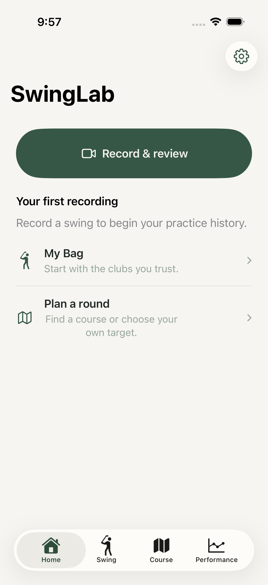
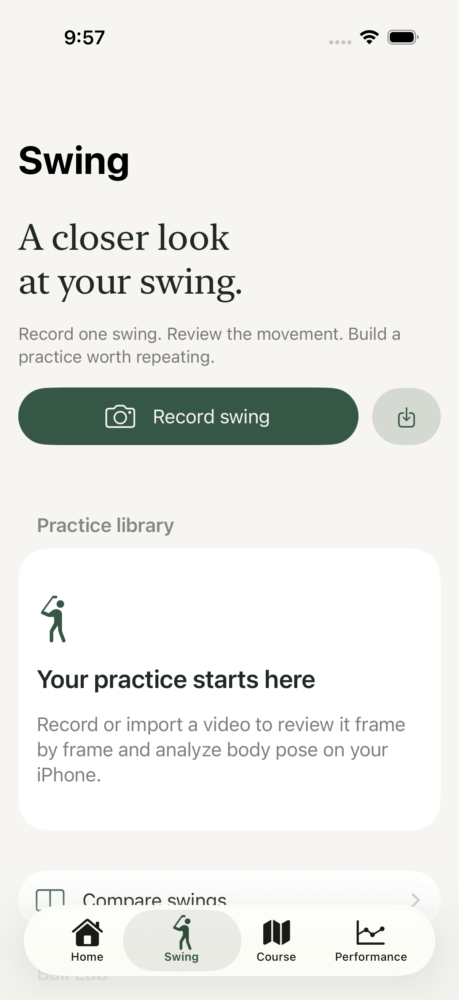
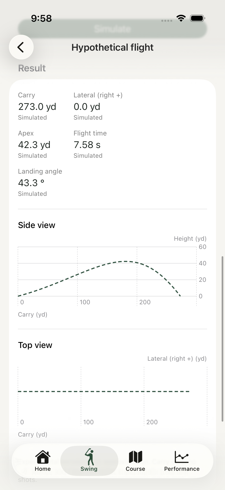
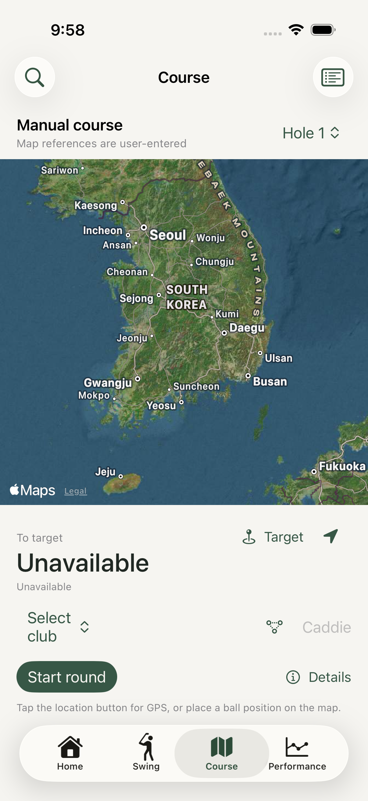
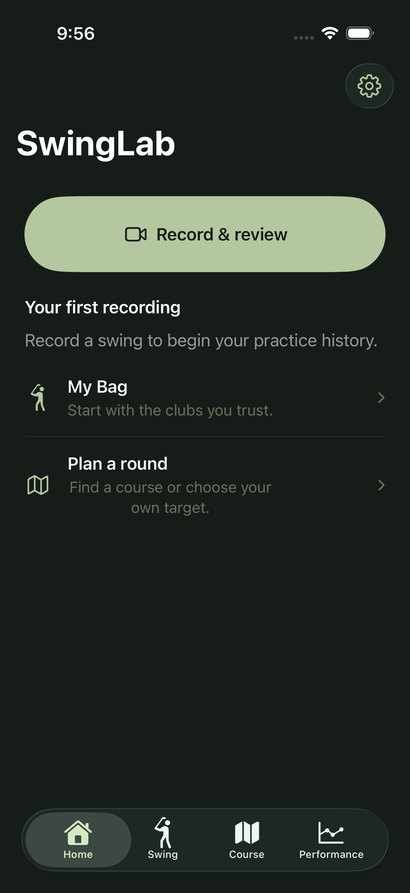
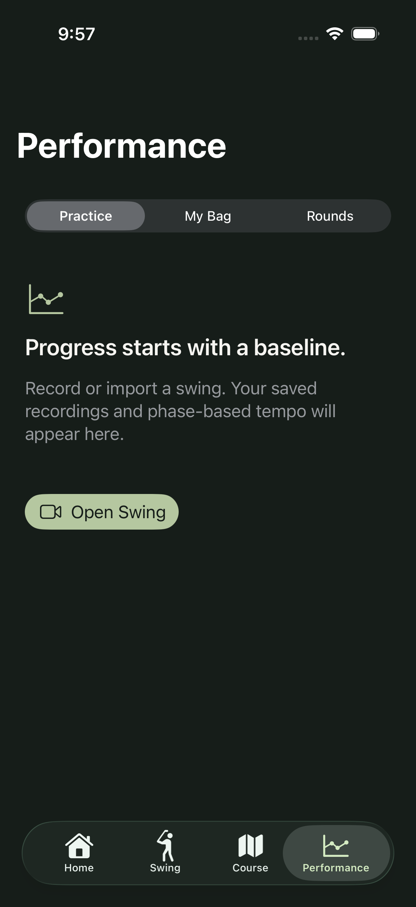
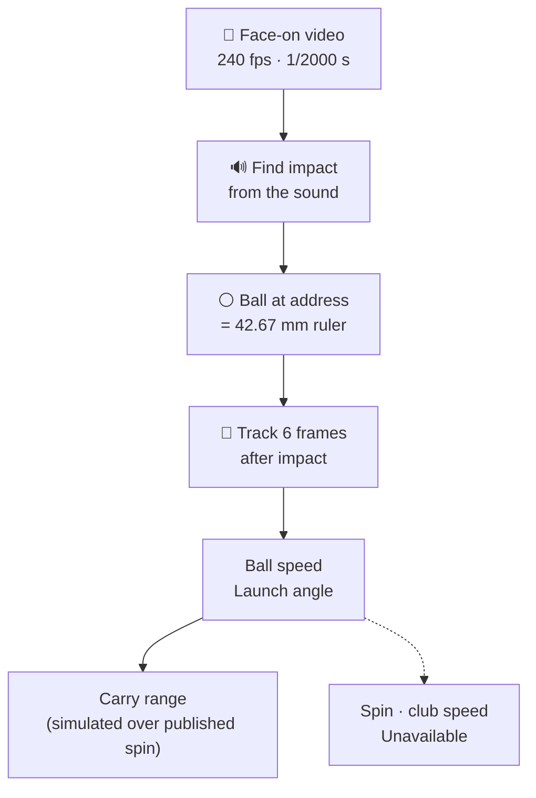

<p align="center">
  <picture>
    <source media="(prefers-color-scheme: dark)" srcset="Docs/Assets/banner-dark.svg">
    
  </picture>
</p>

<p align="center">
  <a href="https://github.com/jongsu-king/SwingLab/actions/workflows/core-tests.yml"></a>
  
  
  
  
  
  
</p>

<p align="center"><a href="README.md">한국어</a> · <b>English</b></p>

<p align="center">
  A native iPhone golf app: record your swing, measure ball speed and launch angle, and pick a club on the course.<br>
  <b>When a number can't be known, it says "Unavailable" instead of inventing one.</b>
</p>

---

## Preview

<p align="center">
  
  
  
  
</p>
<p align="center">
  
  
  
  
</p>
<p align="center"><sub>iPhone 17 Pro simulator (iOS 26.4), round 4. Home · Swing · Hypothetical flight · Course / Add club · Dark mode · Performance · Korean</sub></p>

## What it does

- 🎥 **Swing capture and review**: high-frame-rate recording (120/240 fps where the device supports it) with sound. Vision 2D pose, eight swing phases from address to finish, and tempo. Impact is located from the recorded strike sound.
- 🎯 **Launch monitor** <sub>experimental</sub>: film face-on at 240 fps with a 1/2000 s shutter. The ball's own diameter (42.67 mm) is the ruler for **ball speed** and **launch angle**.
- 🏌️ **Club catalog**: 2000–2026, **23 brands, 1,515 clubs, 93 shafts, 17 hosel systems**. Custom shafts, length in 0.25" steps, and the loft/lie change for each sleeve position.
- 🪂 **Hypothetical flight**: enter ball speed, launch, and spin; an RK4 physics model simulates carry, apex, and landing angle.
- 🗺️ **Course and rounds**: MapKit course search, GPS distances, 9/18-hole scorecards, shot logging, and 50 %/80 % landing regions from your own club data.
- 📈 **Performance and coaching**: practice sessions, club gapping, consistency. Coaching appears only with enough evidence (5+ swings at the same angle with the same club).
- 🌏 **12 languages, independent units**: English, Korean, Japanese, Chinese (Simplified and Traditional), Spanish, Portuguese, German, French, Italian, Thai, Vietnamese. Distance, speed, wind, and temperature units switch separately.
- 🔒 **Local-first**: no account, ads, analytics SDK, or server. Videos stay on the device.

## Every number shows where it came from

Each value on screen carries its origin. Values one iPhone camera cannot observe are never filled in with plausible guesses.

| Label in the app | Meaning · examples |
|---|---|
| Measured | Device sensor · GPS distance, frame time |
| Vision-derived | From video · pose, ball speed, launch angle |
| Audio-derived | From recorded sound · impact time |
| Estimated | Rule-based, editable · swing phases |
| Simulated | Physics model · carry range, hypothetical flight |
| User-entered | Typed in by you · club averages, scores |
| **Unavailable** | Not knowable with one iPhone · **spin, club speed** |

## How the launch monitor works



- On synthetic video it is within 0.1 % on ball speed and 0.01° on launch angle.
- It has not been checked on real shots yet. The "Experimental" label comes off only after **10+ shots beside a TrackMan land within ±3 % on ball speed and ±1.5° on launch angle**.
- Design: [Docs/Specs/LaunchMonitor.md](Docs/Specs/LaunchMonitor.md)

## Status

> [!NOTE]
> In development; not on the App Store yet. The acceptance scorecard is in [Docs/Acceptance.md](Docs/Acceptance.md).

| Check | Result |
|---|---|
| iOS build (Swift 6) | ✅ 0 errors · 0 warnings |
| Core tests | ✅ 80 / 80 |
| App · UI tests (2 simulators) | ✅ 22 + 9 |
| Strings in 12 languages | ✅ 0 missing / 670 |
| Real-iPhone capture · pose · GPS | ⬜ waiting for a device |
| Launch monitor accuracy | ⬜ waiting for TrackMan shots |
| App Store readiness | ❌ needs a developer account |

<sub>App · UI tests: iPhone 17 Pro (iOS 26.4), iPhone Duo (iOS 27.1)</sub>

## How it is built

SwingLab is built in **rounds**: Codex implements, and a reviewer runs the code to verify it. Each round gets a stronger prompt, and each side reviews and rebuts the other's code. A report that says "all tests pass" doesn't count until the reviewer reproduces it.

- **Round 1** · [v6.0](Docs/Prompts/v6.0.md): app foundation, four tabs, capture, pose, course  
  [Review](Docs/Review/round-1-review.md) · [Response](Docs/Review/round-1-response.md) · [Rebuttal](Docs/Review/round-1-rebuttal.md)
- **Round 2** · [v7.0](Docs/Prompts/v7.0.md): swing phases, impact from sound, flight physics, coaching  
  [Review](Docs/Review/round-2-review.md) · [Rebuttal](Docs/Review/round-2-rebuttal.md)
- **Round 3** · [v8.0](Docs/Prompts/v8.0.md): first native build, simulator tests, practice sessions  
  [Response](Docs/Review/round-3-response.md)
- **Round 4** · [v9.0](Docs/Prompts/v9.0.md): club catalog, published reference data, both simulators green, launch monitor  
  [Review](Docs/Review/round-4-review.md)

Per-round notes are on the [Releases](https://github.com/jongsu-king/SwingLab/releases) page.

## Build it yourself

You need Xcode 27.1 or later; the app targets iOS 17 and later. There are no third-party libraries or API keys.

```bash
git clone https://github.com/jongsu-king/SwingLab.git
```

```bash
open SwingLab/SwingLab.xcodeproj
```

Choose the **SwingLab** scheme and an iPhone simulator, then run. For a real iPhone, set your development team and bundle ID in Signing & Capabilities.

<details>
<summary>Test commands</summary>

```bash
swift test
```

```bash
Scripts/verify.sh
```

```bash
xcodebuild -project SwingLab.xcodeproj -scheme SwingLab -destination 'platform=iOS Simulator,name=iPhone 17 Pro' test
```

</details>

<details>
<summary>Repository map</summary>

| Path | Contents |
|---|---|
| `SwingLab/App` | App lifecycle, tabs, onboarding |
| `SwingLab/Features` | Screens: swing, course, performance, bag, hypothetical flight, launch monitor |
| `SwingLab/Services` | Camera, video, pose, location, launch video analysis |
| `SwingLab/Resources/Catalog` | Club, shaft, and hosel catalog JSON |
| `Sources/SwingLabCore` | UI-free logic: units, swing phases, impact sound, flight physics, launch tracking, landing regions |
| `Tests`, `SwingLabTests`, `SwingLabUITests` | Core, app, and UI tests |
| `Scripts` | Project generation, translation build, catalog validation |
| `Docs` | Prompts, reviews, round reports, design notes, screenshots |

After adding a source file, run `python3 Scripts/generate_project.py`. After editing translations, run `python3 Scripts/build_localizations.py`.

</details>

## Privacy

No account, no ads or analytics SDK, no upload server. Recordings and records stay on the device and can be deleted at once from Settings. See [Docs/PrivacyPolicy.md](Docs/PrivacyPolicy.md).
