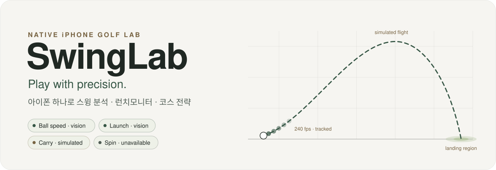
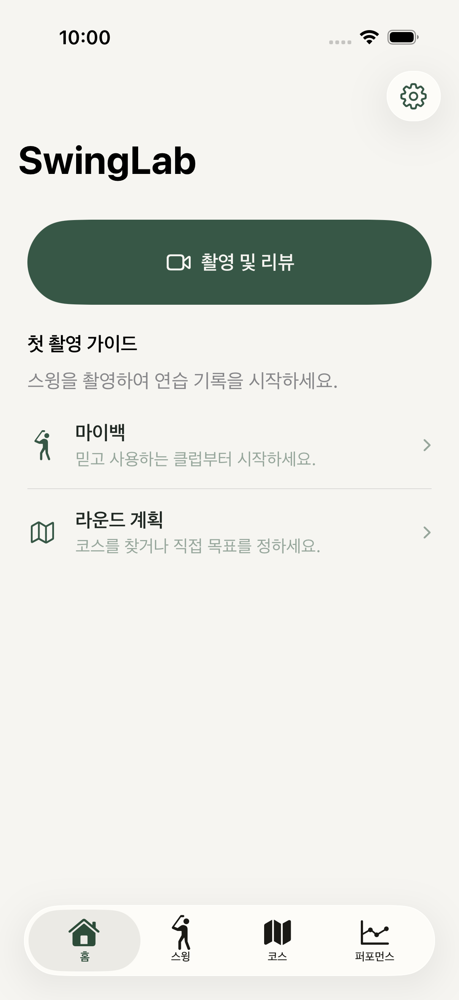
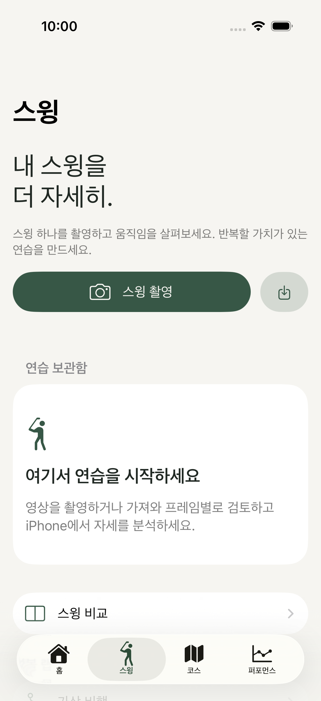
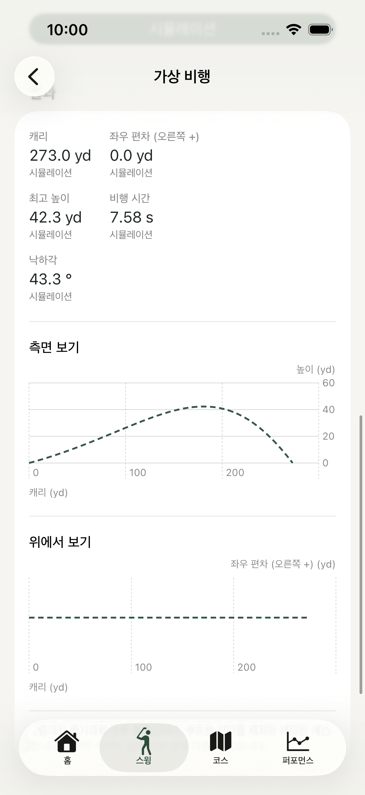
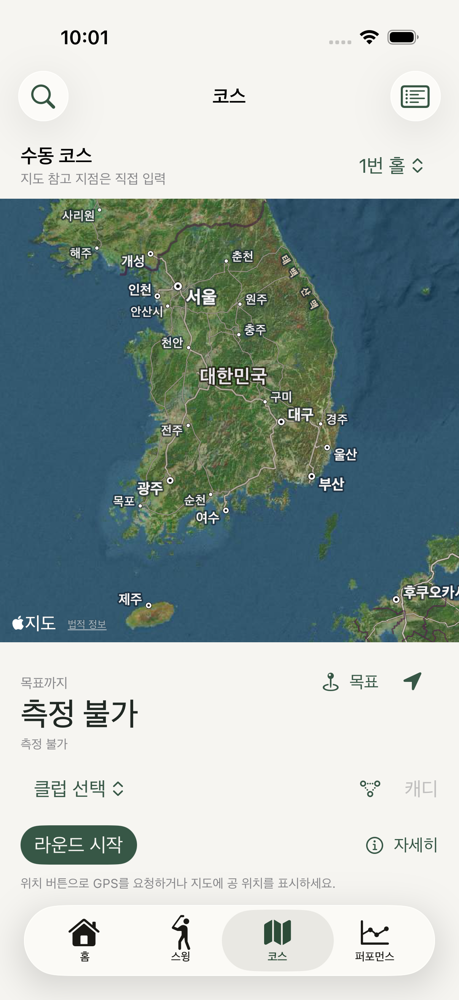
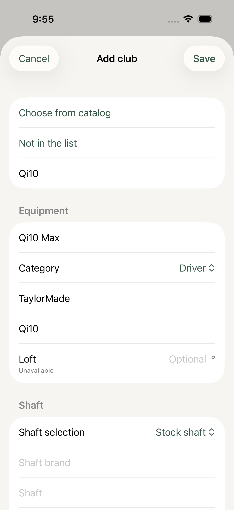
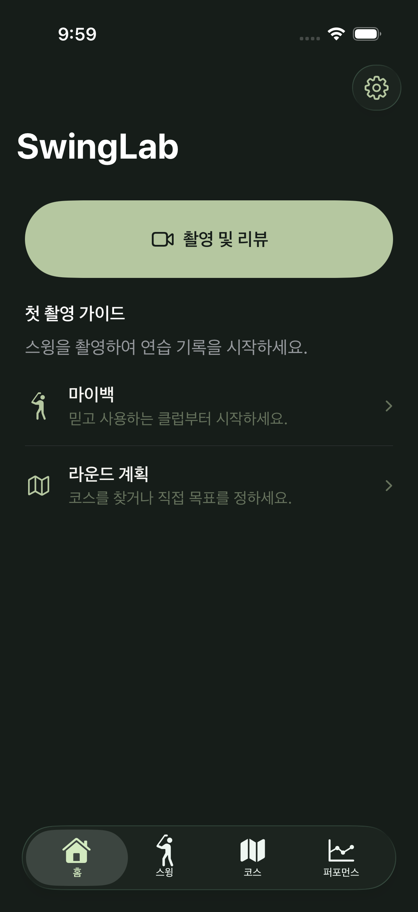
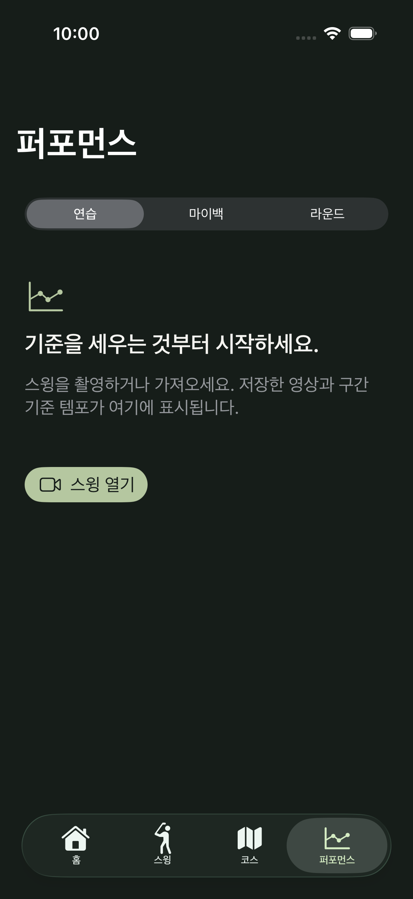
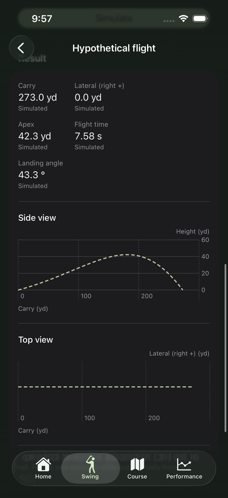
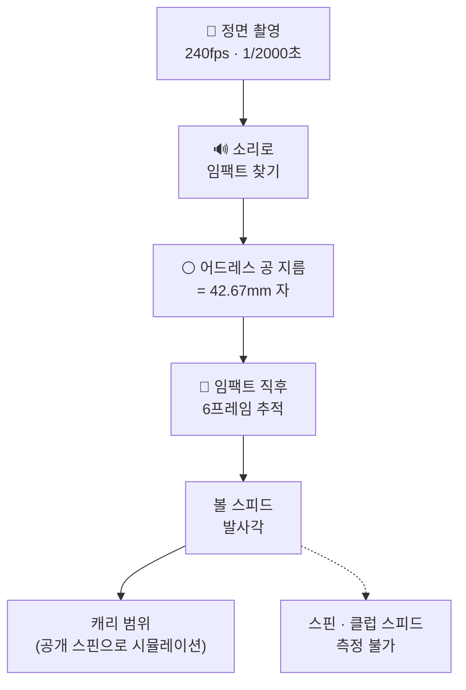

<p align="center">
  <picture>
    <source media="(prefers-color-scheme: dark)" srcset="Docs/Assets/banner-dark.svg">
    
  </picture>
</p>

<p align="center">
  <a href="https://github.com/jongsu-king/SwingLab/actions/workflows/core-tests.yml"></a>
  
  
  
  
  
  
  <a href="https://doi.org/10.5281/zenodo.23682465"></a>
</p>

<p align="center"><b>한국어</b> · <a href="README.en.md">English</a></p>

<p align="center">
  아이폰 하나로 스윙을 찍고, 볼 스피드와 발사각을 재고, 코스에서 클럽을 고르는 네이티브 골프 앱.<br>
  <b>모르는 숫자는 지어내지 않고 "측정 불가"라고 말합니다.</b>
</p>

---

## 미리보기

<p align="center">
  
  
  
  
</p>
<p align="center">
  
  
  
  
</p>
<p align="center"><sub>iPhone 17 Pro 시뮬레이터 (iOS 26.4), 4라운드. 홈 · 스윙 · 가상 비행 · 코스 / 클럽 추가 · 다크 모드 · 퍼포먼스 · 영어 화면</sub></p>

## 할 수 있는 것

- 🎥 **스윙 촬영·분석**: 기기가 지원하는 고속 촬영(120/240fps)과 소리 녹음. Vision 2D 자세 추정, 8단계 스윙 구간(어드레스~피니시), 템포. 임팩트 순간은 녹음된 타구음으로 찾아요.
- 🎯 **런치모니터** <sub>실험적</sub>: 정면에서 240fps, 셔터 1/2000초로 찍으면 공 지름(42.67mm)을 자로 삼아 **볼 스피드**와 **발사각**을 계산해요. 촬영 화면에서 **실시간 측정**을 켜면 타구음을 듣고 바로 값을 보여주고, 찍어 둔 영상으로도 잴 수 있어요. 잰 샷은 **런치 기록**에 쌓이고 클럽별 평균을 보여줘요.
- 🏌️ **클럽 카탈로그**: 2000~2026년 **23개 브랜드, 클럽 1,515개, 샤프트 93종, 슬리브 17종**. 커스텀 샤프트, 0.25인치 단위 길이, 슬리브 위치별 로프트·라이 변화까지 입력해요.
- 🪂 **가상 비행**: 볼 스피드, 발사각, 스핀을 넣으면 RK4 물리 모델로 캐리, 최고 높이, 낙하각을 시뮬레이션해요.
- 🗺️ **코스·라운드**: MapKit 코스 검색, GPS 거리, 9/18홀 스코어카드, 샷 기록. 내 클럽 데이터로 50%/80% 낙하 영역을 그려요.
- 📈 **퍼포먼스·코칭**: 연습 세션, 클럽 갭, 일관성. 근거가 충분할 때만(같은 각도·클럽 5회 이상) 코칭 문장을 보여줘요.
- 🌏 **12개 언어 · 독립 단위**: 한국어, 영어, 일본어, 중국어(간체·번체), 스페인어, 포르투갈어, 독일어, 프랑스어, 이탈리아어, 태국어, 베트남어. 거리·속도·풍속·온도 단위를 따로 바꿀 수 있어요.
- 🔒 **로컬 우선**: 계정, 광고, 분석 SDK, 서버가 없어요. 영상은 기기 안에만 저장돼요.

## 숫자의 출처를 항상 보여줘요

화면의 모든 숫자에는 어디서 왔는지가 붙어 있어요. 아이폰 카메라 한 대로는 알 수 없는 값을 그럴듯하게 채우지 않아요.

| 앱 표시 | 뜻 · 예시 |
|---|---|
| 측정값 | 기기 센서로 잰 값 · GPS 거리, 프레임 시간 |
| 비전 분석값 | 영상 분석 · 자세, 볼 스피드, 발사각 |
| 오디오 기반 | 녹음된 소리 · 임팩트 시각 |
| 추정값 | 규칙으로 추정, 직접 수정 가능 · 스윙 구간 |
| 시뮬레이션 | 물리 모델 계산 · 캐리 범위, 가상 비행 |
| 사용자 입력 | 직접 입력 · 클럽 평균 거리, 스코어 |
| **측정 불가** | 아이폰 한 대로는 알 수 없음 · **스핀, 클럽 스피드** |

## 런치모니터는 이렇게 동작해요



- 합성 영상에서는 볼 스피드 오차 0.1%, 발사각 오차 0.01° 이내예요.
- 실시간 측정은 마이크로 타구음을 듣고, 버퍼에 담아 둔 직전·직후 프레임으로 같은 계산을 해요. 합성 스트림에서는 임팩트 후 약 0.1초 만에 계산할 프레임이 모여요. 실제 iPhone에서의 지연 시간은 아직 재지 않았어요.
- 실제 샷으로는 아직 검증하지 않았어요. **TrackMan 옆에서 10샷 이상 찍어 볼 스피드 ±3%, 발사각 ±1.5° 안에 들어야** "실험적" 표시를 뗄 수 있어요.
- 자세한 설계: [Docs/Specs/LaunchMonitor.md](Docs/Specs/LaunchMonitor.md)

## 지금 상태

> [!NOTE]
> 개발 중이에요. App Store에는 아직 없어요. 합격 기준표는 [Docs/Acceptance.md](Docs/Acceptance.md)에 있어요.

| 검사 | 결과 |
|---|---|
| iOS 빌드 (Swift 6) | ✅ 에러 0 · 경고 0 |
| 코어 테스트 | ✅ 85 / 85 |
| 앱 · UI 테스트 (시뮬레이터 2종) | ✅ 29 + 9 |
| 12개 언어 문구 | ✅ 누락 0 / 689 |
| 실제 iPhone 촬영 · 자세 · GPS | ⬜ 실기기 대기 |
| 런치모니터 정확도 | ⬜ TrackMan 비교 대기 |
| App Store 준비 | ❌ 개발자 계정 필요 |

<sub>앱 · UI 테스트: iPhone 17 Pro (iOS 26.4), iPhone Duo (iOS 27.1)</sub>

## 만드는 방식

Codex가 구현하고, 리뷰어가 코드를 직접 돌려 보며 검증하는 **라운드** 방식으로 만들고 있어요. 매 라운드마다 더 강한 프롬프트를 쓰고, 서로의 코드를 리뷰하고 반박해요. "전부 통과했다"는 보고도 리뷰어가 재현하기 전에는 인정하지 않아요.

- **1라운드** · [v6.0](Docs/Prompts/v6.0.md): 앱 기본 구조, 4개 탭, 촬영, 자세 분석, 코스  
  [리뷰](Docs/Review/round-1-review.md) · [응답](Docs/Review/round-1-response.md) · [반박](Docs/Review/round-1-rebuttal.md)
- **2라운드** · [v7.0](Docs/Prompts/v7.0.md): 스윙 구간 감지, 타구음으로 임팩트 찾기, 비행 물리, 코칭  
  [리뷰](Docs/Review/round-2-review.md) · [반박](Docs/Review/round-2-rebuttal.md)
- **3라운드** · [v8.0](Docs/Prompts/v8.0.md): 첫 네이티브 빌드, 시뮬레이터 테스트, 연습 세션  
  [응답](Docs/Review/round-3-response.md)
- **4라운드** · [v9.0](Docs/Prompts/v9.0.md): 클럽 카탈로그, 공개 참고 데이터, 두 시뮬레이터 통과, 런치모니터  
  [리뷰](Docs/Review/round-4-review.md)

라운드별 변경 내용은 [Releases](https://github.com/jongsu-king/SwingLab/releases)에서 볼 수 있어요.

## 직접 빌드하기

필요한 것: Xcode 27.1 이상, iOS 17 이상. 외부 라이브러리와 API 키는 없어요.

```bash
git clone https://github.com/jongsu-king/SwingLab.git
```

```bash
open SwingLab/SwingLab.xcodeproj
```

**SwingLab** 스킴과 iPhone 시뮬레이터를 고르고 실행하면 돼요. 실제 iPhone에서는 Signing & Capabilities에서 본인 개발 팀과 번들 ID를 지정해야 해요.

<details>
<summary>테스트 명령어</summary>

```bash
swift test
```

```bash
Scripts/verify.sh
```

```bash
xcodebuild -project SwingLab.xcodeproj -scheme SwingLab -destination 'platform=iOS Simulator,name=iPhone 17 Pro' test
```

</details>

<details>
<summary>폴더 구조</summary>

| 경로 | 내용 |
|---|---|
| `SwingLab/App` | 앱 시작, 탭, 온보딩 |
| `SwingLab/Features` | 화면 (스윙, 코스, 퍼포먼스, 마이백, 가상 비행, 런치모니터) |
| `SwingLab/Services` | 카메라, 영상, 자세, 위치, 런치 영상 분석 |
| `SwingLab/Resources/Catalog` | 클럽·샤프트·슬리브 카탈로그 JSON |
| `Sources/SwingLabCore` | UI와 무관한 계산: 단위, 스윙 구간, 임팩트 소리, 비행 물리, 런치 추적, 낙하 영역 |
| `Tests`, `SwingLabTests`, `SwingLabUITests` | 코어·앱·UI 테스트 |
| `Scripts` | 프로젝트 생성, 번역 빌드, 카탈로그 검증 |
| `Docs` | 프롬프트, 리뷰, 라운드 기록, 설계 문서, 스크린샷 |

소스 파일을 추가하면 `python3 Scripts/generate_project.py`, 번역을 고치면 `python3 Scripts/build_localizations.py`를 실행해 주세요.

</details>

## 개인정보

계정이 필요 없고, 광고·분석 SDK와 업로드 서버가 없어요. 촬영한 영상과 기록은 기기 안에만 저장되고, 설정에서 한 번에 지울 수 있어요. 자세한 내용은 [Docs/PrivacyPolicy.md](Docs/PrivacyPolicy.md)에 있어요.

## 라이선스

MIT 라이선스예요. 자세한 내용은 [LICENSE](LICENSE)에 있어요.
